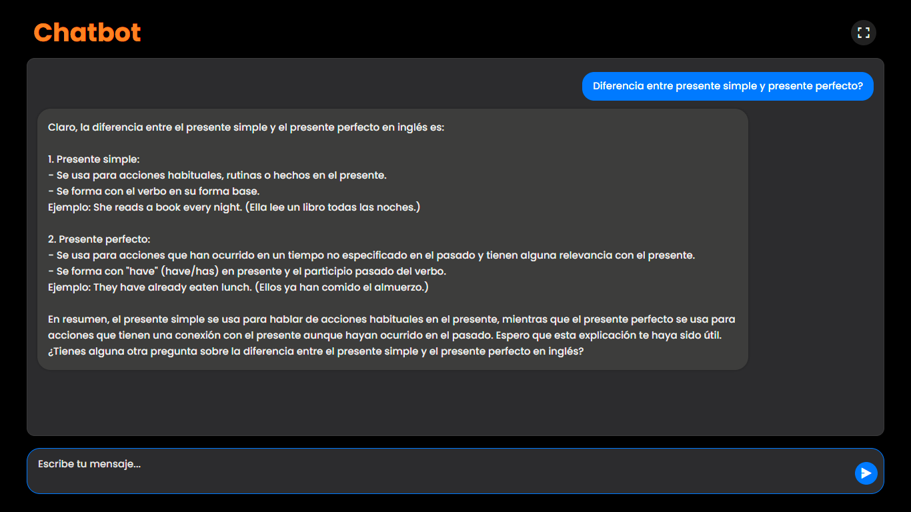
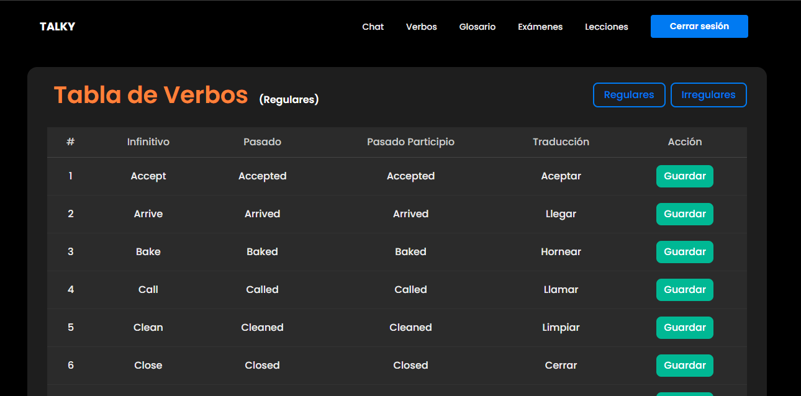

# Talky

[English](README.md) · **Español**

**Talky** es una aplicación web dirigida a estudiantes de inglés. Este repositorio contiene la parte del frontend, construida con React, Vite y TailwindCSS.

La aplicación funciona como un asistente conversacional que permite practicar inglés por medio de un chat interactivo. Incluye herramientas adicionales como un glosario de palabras y una tabla de verbos.

El sistema se conecta con n8n (que a su vez orquesta las llamadas a la API de OpenAI) y usa AWS Cognito y Amplify para la autenticación de usuarios.

<h3>🏆 Certificado mejor proyecto PPI T&T, categoría cuarto semestre, 2025-2</h3>

---

## Funcionalidades del frontend

- Chat interactivo conectado a la API (a través de n8n).
- Autenticación de usuarios con AWS Cognito y Amplify.
- Componentes disponibles:
  - Chat funcional.
  - Tabla de verbos regulares e irregulares.
  - Glosario personalizado por usuario.
  - Registro, inicio de sesión y recuperación de contraseña.
- Interfaz moderna construida con React + Vite + TailwindCSS.

---

## Tecnologías

- Framework: React + Vite
- Estilos: TailwindCSS + CSS personalizado
- Autenticación: AWS Amplify + Cognito
- Integraciones: n8n (orquesta las llamadas a la API de OpenAI)

---

## Seguridad

Este repositorio no incluye claves privadas. La configuración sensible debe guardarse en `amplifyconfiguration.json` y nunca debe subirse al control de versiones. Asegúrate de usar un archivo `.gitignore` adecuado.

---

## Repositorio del backend

El backend de la aplicación está en un repositorio aparte, construido con:
- Java
- Spring Boot
- PostgreSQL
