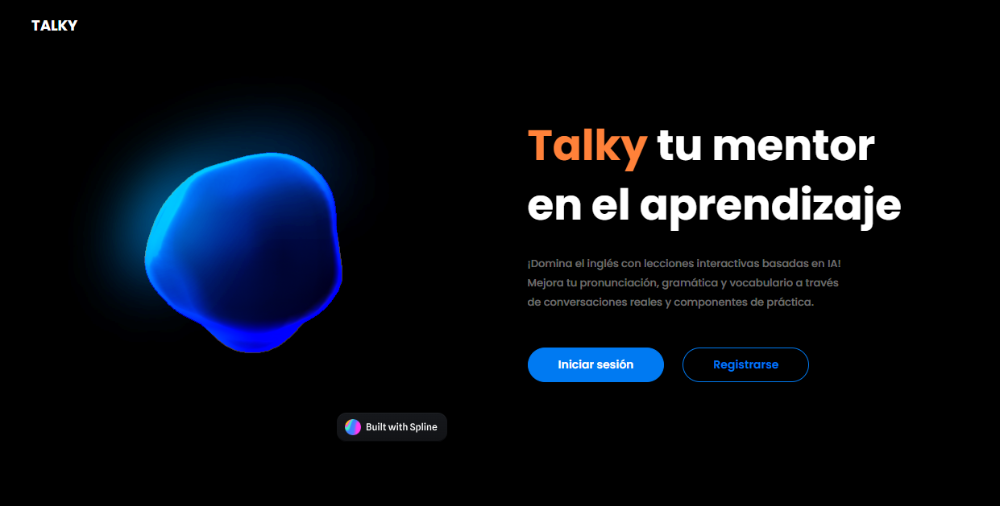
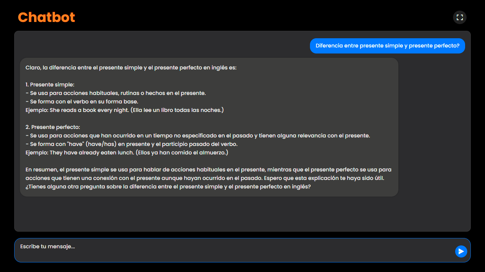
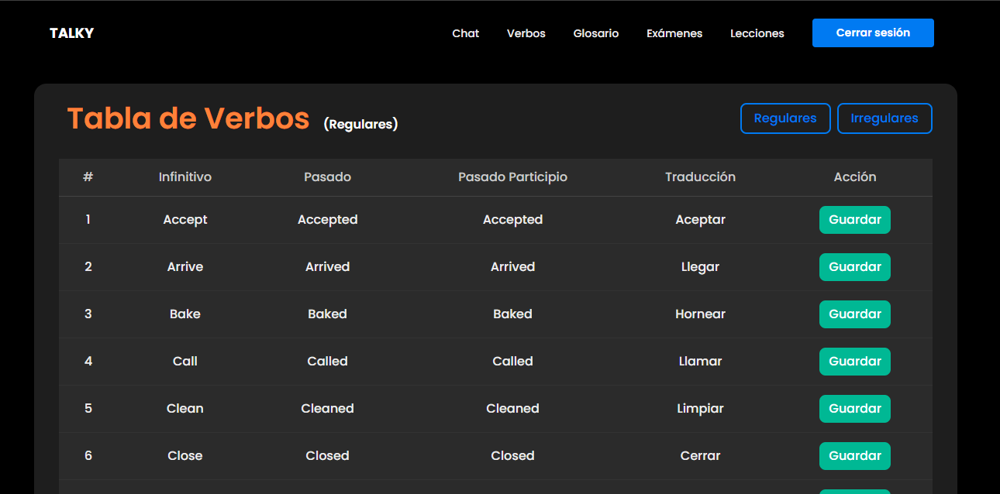

# Talky

**Talky** is a web application aimed at English-language students. This repository contains the frontend portion, built with React, Vite, and TailwindCSS.

The application works as a conversational assistant that lets users practice English through interactive chat. It includes additional tools such as a word glossary and a verb table.

The system connects to n8n — which in turn orchestrates calls to the OpenAI API — and uses AWS Cognito and Amplify for user authentication.

<h3>🏆 Certificate — Best PPI T&T Project, Fourth Semester Category, 2025-2</h3>

---

## Frontend Features

- Interactive chat connected to the API (via n8n).
- User authentication with AWS Cognito and Amplify.
- Available components:
  - Functional chat.
  - Regular and irregular verb table.
  - Per-user custom glossary.
  - Registration, login, and password recovery.
- Modern UI built with React + Vite + TailwindCSS.

---

## Technologies

- Framework: React + Vite
- Styling: TailwindCSS + custom CSS
- Authentication: AWS Amplify + Cognito
- Integrations: n8n (orchestrates calls to the OpenAI API)

---

## Security

This repository does not include private keys. Sensitive configuration must be kept in `amplifyconfiguration.json` and should never be committed to version control. Make sure to use an appropriate `.gitignore` file.

---

## Backend Repository

The application's backend lives in a separate repository, built with:
- Java
- Spring Boot
- PostgreSQL
